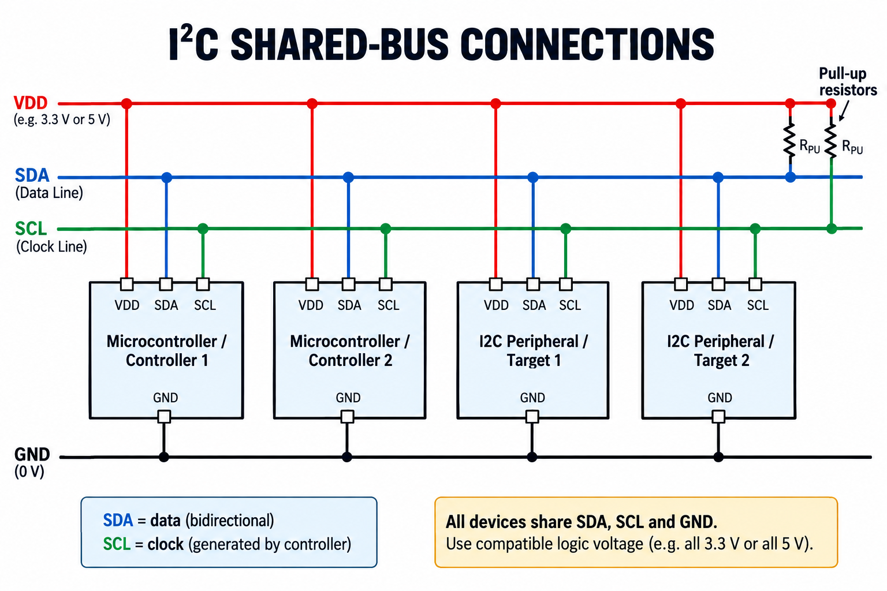
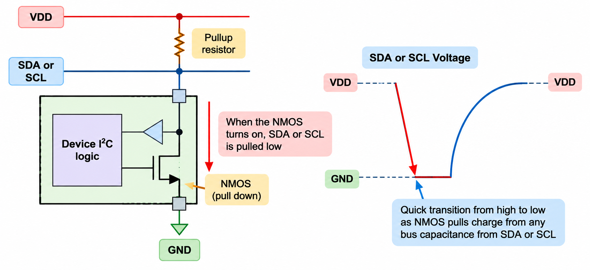
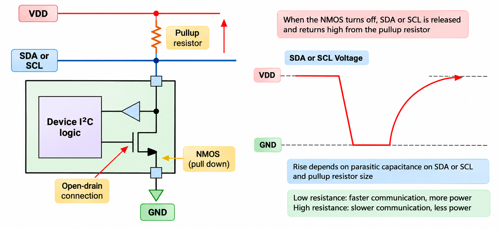
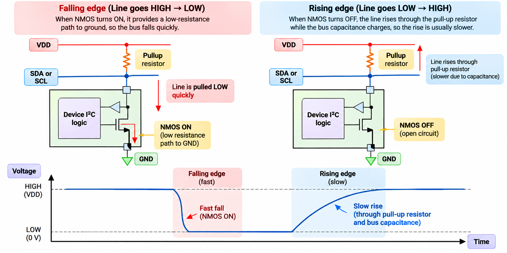
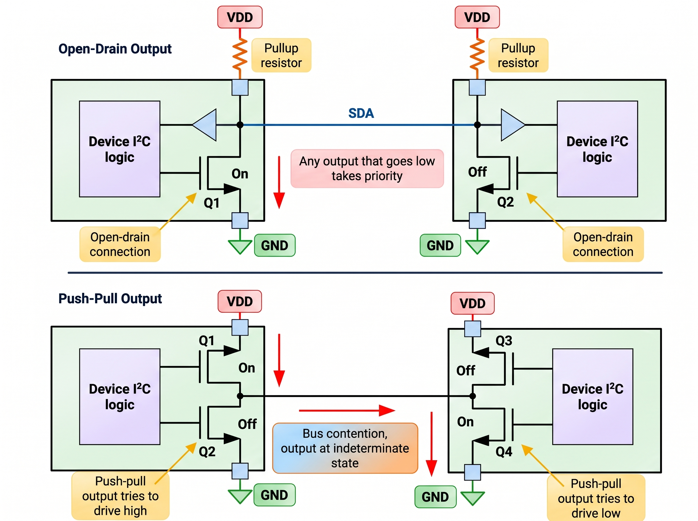
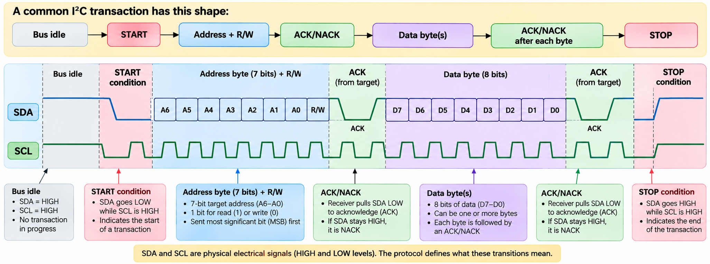
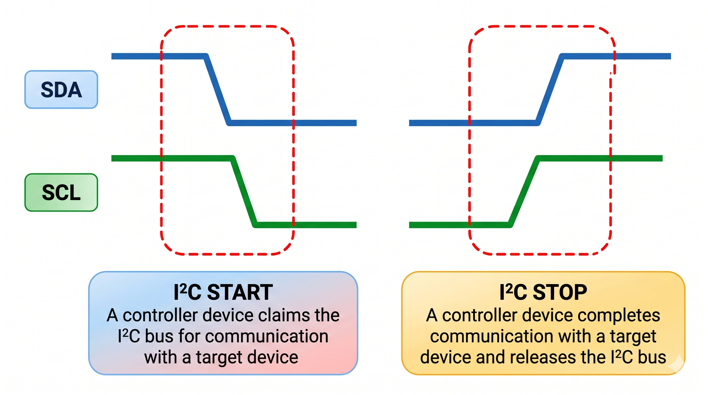
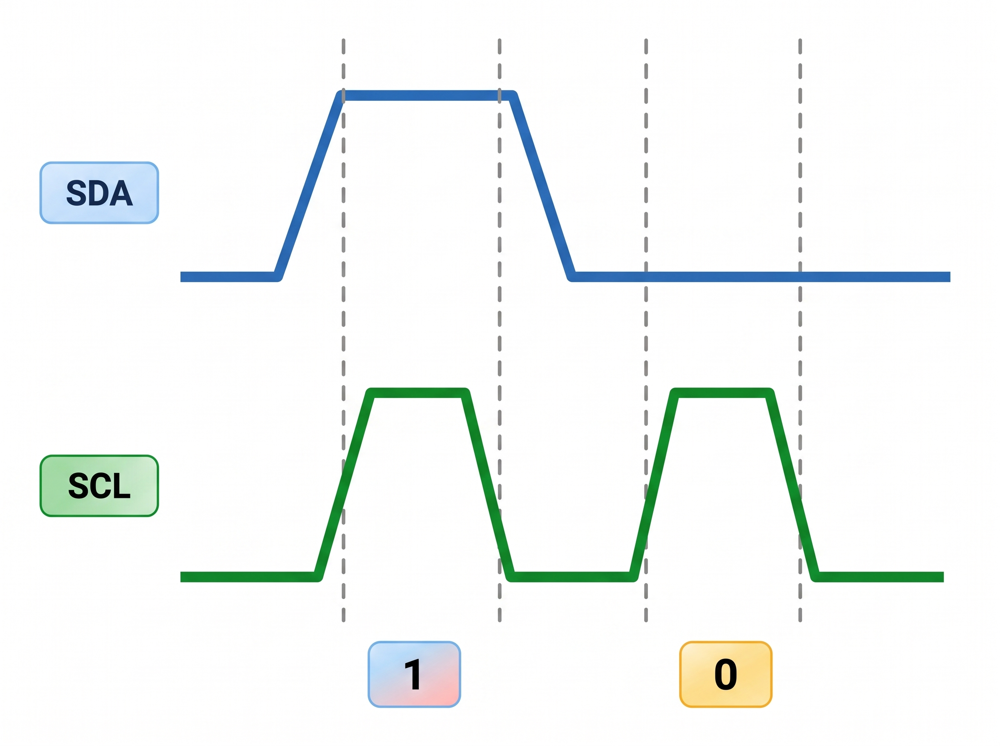
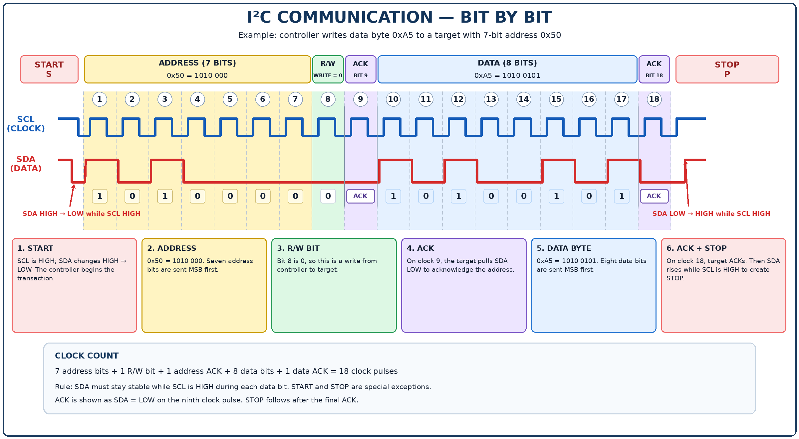

# I²C Protocol — Complete Beginner-Friendly Notes

## Contents

1. [I²C overview](#1-i2c-overview)
2. [A short history of I²C](#11-a-short-history-of-i2c)
3. [I²C speed modes](#12-i2c-speed-modes)
4. [Physical layer: the two-wire bus](#2-physical-layer-the-two-wire-bus)
5. [Open-drain connections and pull-up resistors](#22-open-drain-connections-and-pull-up-resistors)
6. [Why shared open-drain lines avoid destructive contention](#23-why-shared-open-drain-lines-avoid-destructive-contention)
7. [START and STOP conditions](#31-start-and-stop-conditions)
8. [How a logical 1 and 0 are sent](#32-how-a-logical-1-and-0-are-sent)
9. [Communication frames: address, R/W, data, ACK and NACK](#33-communication-frames-address-rw-data-ack-and-nack)
10. [A complete transaction, bit by bit](#4-a-complete-transaction-bit-by-bit)
11. [Common write and read patterns](#5-common-write-and-read-patterns-extra-practical-context)
12. [I²C compared with SPI](#6-i2c-compared-with-spi)
13. [Practical troubleshooting](#7-practical-i2c-troubleshooting)
14. [Quick revision and glossary](#8-quick-revision-and-glossary)
---

## 1. I²C overview

Imagine a microcontroller board with a temperature sensor, a real-time clock, and a small memory chip. The microcontroller needs to ask the sensor for temperature, read the time from the clock, and save a setting in memory. If every peripheral needed its own separate set of communication wires, the board would become crowded quickly.

I²C solves this by letting compatible devices share **two communication wires**:

- **SDA — Serial Data:** carries address bits, commands, and data.
- **SCL — Serial Clock:** provides the timing used to transfer those bits.

The wires are shared, so a controller first indicates which target it wants to talk to. It does this by sending the target's address over SDA. Devices on the bus observe the address, but only the addressed target should respond to that transaction.

I²C is **serial** because bits travel one after another, and **synchronous** because the clock on SCL coordinates the timing. Communication can go in either direction, but the shared SDA line normally carries data in only one direction at a time. That makes ordinary I²C communication **half-duplex**, unlike the usual four-wire SPI arrangement, which has separate send and receive lines and can exchange bits in both directions at once.

### The main words used in I²C

- **Controller** (traditionally called master): normally starts a transaction, supplies the clock, and selects a target using its address.
- **Target** (traditionally called slave): responds when its address is selected and then receives or sends data as instructed.
- **Bus:** the SDA and SCL wires shared by connected devices.
- **Address:** the value used to select a target on the bus.
- **Transaction:** one communication operation, beginning with START and normally ending with STOP.

Some systems support more than one controller. The bus protocol includes rules for those systems, but many beginner projects use one controller with several targets.

### Why engineers use I²C

The biggest attraction is pin saving: multiple peripherals can share two signal lines. Each target has an address, so a controller can choose which one to talk to without using one separate chip-select wire for every device. I²C is widely used for board-level peripherals where its speed and wiring model are appropriate.

---

## 1.1 A short history of I²C

I²C stands for **Inter-Integrated Circuit** and is commonly pronounced “I-squared-C” or “I-two-C.” It was developed by Philips Semiconductor in 1982, a company whose semiconductor business later became part of NXP. It was created as a practical way for controller chips, such as microcontrollers and processors, to communicate with peripheral chips such as data converters.

The supplied reference notes that implementation no longer requires a license since 2006, which helped I²C-compatible devices become widespread across the semiconductor industry.

The historical detail is less important in day-to-day firmware than the design idea: **a small number of shared wires plus addressing can connect many different peripheral types**. Today, I²C is commonly found in sensors, clocks, memory devices, converters, and GPIO expanders.

---

## 1.2 I²C speed modes

I²C has several defined speed modes. The numbers below are the nominal maximum bit rates listed in the supplied Texas Instruments reference.

| Mode | Maximum bit rate | Beginner-friendly explanation |
|---|---:|---|
| Standard-mode | 100 kbit/s | The basic, lower-speed mode; widely supported. |
| Fast-mode | 400 kbit/s | Faster communication when the devices and electrical bus can support it. |
| Fast-mode Plus | 1 Mbit/s | Requires suitable device drivers and tighter rise/fall-time performance. |
| High-speed mode | 3.4 Mbit/s | Requires specific device support and entry into high-speed operation; the bus may need an active pull-up arrangement. |
| Ultra Fast-mode | 5 Mbit/s | A special write-only mode that omits some features of the usual bidirectional I²C protocol. |

### What does the speed number actually mean?

A rate such as 400 kbit/s describes the number of bits transferred per second at the bus level. It does **not** mean the application receives 400,000 useful data bits every second. Address bits, ACK bits, START/STOP timing, and device-specific waits add overhead.

Also, selecting a faster number in the microcontroller configuration is not enough. The target device must support that mode, and SDA/SCL must rise and fall quickly enough. Bus capacitance and pull-up resistor values matter a great deal. If an I²C bus works at 100 kbit/s but becomes unreliable at 400 kbit/s, the issue may be electrical timing rather than the C code.

**Practical rule:** Start with a speed supported by every device on the bus. Increase it only after checking datasheets and confirming signal quality.

---

## 2. Physical layer: the two-wire bus

The **physical layer** is the real electrical connection: the wires, voltage levels, output transistors, pull-up resistors, and pin characteristics. Before thinking about address bits, first make sure the bus can produce valid HIGH and LOW voltage levels.

The two shared lines are:

- **SCL:** the serial clock. It is normally driven by the controller, although clock stretching and multi-controller behavior can affect the timing.
- **SDA:** the serial data line. It carries bits from controller to target or from target to controller.

Every connected device attaches to the same SDA and SCL lines. Devices also need suitable power connections and a shared electrical ground reference for a typical board-level connection. The bus voltage must be safe for all devices.



*How to read this image:* Every device connects to the same SDA and SCL bus. The pull-up resistors keep both lines HIGH when no device pulls them LOW. The diagram shows two controllers to illustrate that I²C can support multi-controller systems; a real design must follow the protocol's arbitration rules. A simpler project usually has only one controller.

### I²C is bidirectional but half-duplex

“Bidirectional” means information can travel from controller to target and from target to controller. “Half-duplex” means the shared SDA wire ordinarily carries data in only one direction at a time.

For example:

1. The controller may send a register address to a sensor.
2. Then the sensor may send back the contents of that register.

Both directions are supported, but SDA is not sending independent outgoing and incoming bit streams simultaneously. This is different from a usual four-wire SPI connection, which uses separate MOSI and MISO data paths.

### Why addressing matters on shared wires

All devices can see transitions on SDA and SCL. The address tells each target whether it is being selected. For a well-designed bus, targets that are not selected do not interfere with the transaction. Some targets have fixed addresses; others let you select a few address bits using hardware pins. Two active targets with the same address on the same bus can both respond, which can make the result unusable. If address conflicts cannot be resolved with address pins, a bus multiplexer or another design change may be needed.

---

## 2.2 Open-drain connections and pull-up resistors

This section explains one of the most important electrical ideas in I²C: **devices normally pull a bus line LOW or release it; they do not actively drive it HIGH in the normal open-drain arrangement**.

Think of each device as having a small electronic switch between the line and ground. The switch is controlled by the device's I²C logic:

-**Switch ON: the device connects the line toward ground, so the line becomes LOW.**



- **Switch OFF: the device stops pulling the line down. It releases the line, and an external pull-up resistor brings the line HIGH.**



The switch is commonly implemented with an NMOS transistor. “Open drain” describes the output arrangement where the drain connection is available to the bus and the transistor can pull that bus toward ground when turned on.

### Why is the pull-up resistor necessary?

When every device releases the line, nothing is actively pushing it HIGH. Without a pull-up (or another explicitly supported arrangement), the line may float and the voltage may not be a reliable logic HIGH. The pull-up resistor connects the line to the appropriate bus supply and establishes a known HIGH level.

Both SDA and SCL need a suitable pull-up arrangement. On development boards, pull-ups may already be fitted, so check the board schematic before adding more.

### Falling edge versus rising edge

When an NMOS transistor turns ON, it provides a relatively low-resistance path toward ground. The bus can therefore fall from HIGH to LOW quickly. When the transistor turns OFF, the line rises through the pull-up resistor while the capacitance of the wire, pins, and PCB traces charges. That rise is usually slower.




This is a conceptual sketch, not a measured waveform. Actual edge shape depends on the device, resistor, capacitance, and probe setup.

### Pull-up resistor trade-off

| Pull-up choice | What usually happens | Trade-off |
|---|---|---|
| Lower resistance | The line charges HIGH more quickly | More current flows when a device holds the line LOW, so power and sink-current demand increase. |
| Higher resistance | Less current flows while the line is LOW | The line rises more slowly, which can violate timing limits at higher speeds. |

The rise-time behavior is related to an RC time constant:

`time constant ≈ pull-up resistance × total bus capacitance`

A larger capacitance or larger resistance makes the rising transition slower. More devices, longer traces, and extra wiring usually increase capacitance. This is why the allowed bus speed depends partly on how much capacitance is connected.

### Practical electrical cautions

- Do not assume a 5 V pull-up is safe for every 3.3 V device.
- Check the allowed voltage and LOW-level sink current in the datasheets.
- Do not add pull-ups blindly if several modules already contain them; parallel resistors reduce the total resistance.
- If the bus is unreliable only at a higher clock rate, measure the waveform or lower the bus speed while investigating pull-up values and capacitance.
- A level shifter may be required when the devices' logic voltages are incompatible.

---

## 2.3 Why shared open-drain lines avoid destructive contention

“Bus contention” means multiple outputs try to control the same line in conflicting ways. I²C's open-drain design makes sharing the line practical because no device should force the line HIGH against a device pulling it LOW.

Suppose two devices share SDA:

- Device A releases SDA.
- Device B pulls SDA LOW.
- The line becomes LOW because B is pulling it down.

There is no direct fight between one device actively driving HIGH and another actively driving LOW. The released output allows the pull-up resistor to establish HIGH only when no device is pulling the line down.

This behavior is often described as a **wired-AND** connection. In practical logic terms, a LOW from any connected open-drain output makes the shared line LOW. LOW therefore dominates the shared wire.

### Open-drain versus push-pull

A push-pull output can actively drive both HIGH and LOW, typically using complementary transistors. That is useful for many digital signals, including common SPI signals, but directly tying push-pull outputs together is dangerous if one output drives HIGH while another drives LOW. That can create a low-impedance current path from supply to ground, cause an invalid voltage, and potentially damage a device.




### Does open-drain mean every kind of contention disappears?

No. It prevents the specific destructive electrical fight that can occur when tied push-pull outputs drive opposite levels, provided all attached devices use compatible open-drain signaling correctly. It does not mean two controllers may ignore protocol rules and send unrelated transactions at the same time. Multi-controller I²C also needs arbitration and synchronization so the controllers determine who continues controlling the transaction.

**Keep these ideas separate:**

- **Electrical sharing:** open-drain plus pull-ups makes the wired line safe to share.
- **Protocol ownership:** START/STOP and multi-controller arbitration coordinate transactions.

---

## 3. I²C protocol: from wires to messages

The physical layer explains how SDA and SCL produce electrical HIGH and LOW levels. The **protocol** explains what those transitions mean: when a transaction starts, how bits are interpreted, how the target is selected, and how a receiver acknowledges a byte.

A common transaction has this shape:




The details can vary with the target device, but START, addressing, byte transfer, acknowledgment, and transaction completion form the basic pattern described in the reference.

---

## 3.1 START and STOP conditions

### START: “I am beginning a transaction”

A START condition is created when **SDA changes from HIGH to LOW while SCL is HIGH**. This special transition tells devices watching the bus that a transaction is beginning.

The controller normally generates the START. Once the bus is claimed, the controller brings SCL LOW to begin clocking the address and data bits. If multiple controllers exist, they must follow the I²C arbitration rules rather than assume only one controller is present.

### STOP: “I have finished this transaction”

A STOP condition is created when **SDA changes from LOW to HIGH while SCL is HIGH**. It tells the bus that the controller has completed the transaction and released the bus for a future transaction.

The key rule is that SDA normally remains stable while SCL is HIGH during an ordinary data bit. The special SDA transition while SCL is HIGH is how START and STOP are recognized.



**Memory tip:** START is a falling transition on SDA while the clock is HIGH. STOP is a rising transition on SDA while the clock is HIGH.

---

## 3.2 How a logical 1 and 0 are sent

SDA carries the data bit, and SCL provides the timing. In the common open-drain arrangement:

- To send a logical **0**, the transmitting device pulls SDA LOW.
- To send a logical **1**, the transmitting device releases SDA, allowing the pull-up resistor to make it HIGH.



So a logical 1 does not mean the device must actively push SDA up to VDD. It means that the device releases the line and the bus is pulled HIGH, assuming no other device is holding it LOW.


### How does the receiver know which value was sent?

The clock tells the receiver when to look at SDA. During a normal data bit, SDA should remain stable while SCL is HIGH; the receiver samples the level according to the I²C timing rules. Then SCL returns LOW and the next bit can be prepared.

```text
One bit (conceptual)

SCL:  ____/‾‾‾‾\____
SDA:  --------  HIGH  -> interpreted as 1

Another bit

SCL:  ____/‾‾‾‾\____
SDA:  _________ LOW   -> interpreted as 0
```

These are simplified sketches. Real waveforms have finite rise/fall times and must satisfy the timing requirements for the chosen I²C mode.

### Why must SDA remain stable while SCL is HIGH?

Because the receiver interprets SDA as the bit value during the clock's valid sampling period. If SDA changes while SCL is HIGH, the transition can look like START or STOP rather than a normal data change. That is why data usually changes while SCL is LOW and is sampled while SCL is HIGH, within the device's timing requirements.

---

## 3.3 Communication frames: address, R/W, data, ACK and NACK

I²C communication is grouped into **frames**. A frame is a unit of the transfer with a defined structure. In the basic 7-bit-address format shown in the reference, communication starts with an address frame and is followed by one or more data frames.

### The address frame

The usual 7-bit address frame contains:

1. Seven address bits (`A6` through `A0`), transmitted most-significant bit first.
2. One read/write bit (`R/W`).
3. One acknowledgment bit from the receiver.

```text
Address frame (9 clock pulses)

| A6 | A5 | A4 | A3 | A2 | A1 | A0 | R/W | ACK/NACK |
|------ seven address bits --------|  1  |   1 bit  |
```

Seven bits can represent 128 bit patterns (`2^7 = 128`), but some addresses are reserved by the specification. Therefore, the number of ordinary addresses available for arbitrary device assignment is smaller than 128.

Each target's address must be known to the controller. Some datasheets give an address as a 7-bit value, while tools or firmware APIs may display or accept a shifted address byte that includes the R/W bit. Check the API documentation carefully so you do not accidentally shift the address twice.

### The R/W bit

The eighth bit after the seven address bits determines the intended direction:

- `R/W = 0`: controller writes to the target.
- `R/W = 1`: controller reads from the target.

This bit belongs to the address phase; it is not one of the seven address bits.

### The data frame

After the address has been acknowledged, data travels in bytes. A byte contains eight bits, commonly sent most-significant bit first. After each byte there is a ninth clock for ACK/NACK.

```text
Data frame (9 clock pulses)

| D7 | D6 | D5 | D4 | D3 | D2 | D1 | D0 | ACK/NACK |
|------------- eight data bits ---------|   1 bit  |
```

The meaning of those eight bits is defined by the target device, not by I²C itself. They might be a register number, a configuration value, a sensor reading, a command, or part of a larger data value.

### ACK and NACK

After eight bits, the receiver responds on the ninth clock:

- **ACK (acknowledge):** receiver pulls SDA LOW during the acknowledgment clock.
- **NACK (not acknowledge):** SDA is not pulled LOW, so it reads HIGH during that clock.

Who sends ACK depends on who received the byte:

- After the controller sends an address, the target normally ACKs if it recognizes and accepts that address.
- During a write, the target normally ACKs each data byte it accepts.
- During a read, the controller is receiving data, so the controller ACKs a byte when it wants more data. It commonly NACKs the final byte to indicate it is done receiving.

An ACK is useful evidence, but it is not proof that the application-level operation succeeded. For example, a device might acknowledge a byte even if the application later reports a conversion error or a status flag indicates that the requested operation is incomplete.

### What does a NACK tell you?

A NACK is a clue about where the transaction failed. If the address is NACKed, check the target address, target power/reset state, wiring, pull-ups, and whether the target is ready. If a data byte is NACKed, check the target's command/register requirements and whether that byte is valid at that point in the sequence.

### START through STOP: the full basic shape

```text
START
  |
  v
7-bit address + R/W bit
  |
  v
Target ACK or NACK
  |
  v
8-bit data byte + ACK/NACK
  |
  +---- another data byte + ACK/NACK (if required)
  |
  v
STOP
```

This is the foundation for understanding I²C transactions on a logic analyzer. Once you can identify START, the address, R/W, each byte, each ACK/NACK, and STOP, the bus trace becomes much easier to read.

---

## 4. A complete transaction, bit by bit

The image below shows a **teaching example** in which a controller writes the byte `0xA5` to a target whose 7-bit address is `0x50`. The chosen address and data are illustrative; they do not describe a particular real sensor or memory chip.



### Read the transaction from left to right

1. **START:** SDA falls while SCL is HIGH. The controller begins a transaction.
2. **Seven address bits:** Address `0x50` is binary `1010000`; these seven bits are transmitted first.
3. **R/W bit:** The next bit is `0`, meaning the controller wants to write.
4. **Address ACK:** The target pulls SDA LOW on the ninth clock if it recognizes and accepts the address.
5. **Eight data bits:** `0xA5` is binary `10100101`, sent most-significant bit first.
6. **Data ACK:** The target pulls SDA LOW on the ninth clock if it accepts the byte.
7. **STOP:** SDA rises while SCL is HIGH, completing the transaction.

### Count the clocks

The address phase uses seven address bits + one R/W bit + one ACK/NACK bit = **9 clock pulses**. The data phase uses eight data bits + one ACK/NACK bit = **9 more clock pulses**. In this simple example there are 18 clock pulses for the address and one data byte, not counting START/STOP transitions as clock pulses.

The controller supplies the clock pulses. The target supplies the ACK after the address and, for a write, after the data byte.

---

## 5. Common write and read patterns (extra practical context)

### 5.1 A simple write

Imagine the controller needs to write a setting to a peripheral. A common pattern is:

```text
START
--Target address + Write (R/W = 0)
---ACK from target
----Command/register byte
-----ACK from target
------Data byte
-------ACK from target
--------STOP
```

For a fictional target at address `0x50`, firmware might send register `0x02` and then value `0x7F`. The bus operation could be conceptually expressed as:

```text
START -> Address 0x50/W -> ACK -> Register 0x02 -> ACK
      -> Value 0x7F -> ACK -> STOP
```

This is a generic example. Some devices expect a different command format, multiple register-address bytes, or no register byte at all.

### 5.2 A common register read

Many sensors and memory devices have registers. Before reading a register, the controller may need to tell the target which register it wants. A common pattern is to write the register number, then issue a **repeated START**, send the address with the read bit set, and receive data.

```text
START
Target address + Write
ACK
Register number
ACK
REPEATED START
Target address + Read
ACK
Data byte from target
NACK from controller (final byte)
STOP
```

A repeated START is another START condition issued before the controller sends STOP. It keeps the operation as a combined transaction rather than ending one transaction and starting an unrelated one. Not all devices require this pattern; follow the datasheet.

### 5.3 What happens during a read?

When the controller reads, the target is the transmitter for the data byte and the controller is the receiver. After each received byte, the controller indicates whether it wants to continue. It typically ACKs if more data should follow and NACKs the last byte before STOP.

This can feel backwards at first: the controller starts the transaction and generates the clock, but the target can drive SDA during the data phase of a read. SCL still provides the timing.

---

## 6. I²C compared with SPI

I²C and SPI are both widely used to connect a microcontroller to nearby peripheral chips, but their wiring and transfer methods differ.

| Feature | I²C | Typical four-wire SPI |
|---|---|---|
| Main communication signals | SDA and SCL | SCLK, MOSI, MISO, and CS |
| Data wiring | One shared bidirectional data line | Separate data-out and data-in lines |
| Transfer direction | Half-duplex on SDA | Can be full-duplex |
| Device selection | Address sent on the bus | Usually a dedicated chip-select per target |
| Pull-ups | Commonly required on SDA and SCL | Usually not required on standard push-pull SPI signals |
| Acknowledgment | ACK/NACK in the basic protocol | No universal ACK/NACK in the base SPI interface |
| Common advantage | Saves signal pins with multiple addressed targets | Often higher throughput for short local links |

Neither is automatically better. I²C is attractive when several low- or moderate-speed peripherals can share two wires. SPI is often a better fit when a device needs higher throughput or simultaneous input/output and extra wires are acceptable. The specific devices' capabilities and the board's electrical design should decide.

---

## 7. Practical I²C troubleshooting

When an I²C peripheral does not respond, try to discover **which stage fails** instead of changing several settings at once.

### Step-by-step checks

1. **Check power and reset.** Is the target powered, correctly reset, and ready to communicate?
2. **Check ground and wiring.** Are SDA and SCL connected to the right pins, and is there a suitable shared ground reference?
3. **Check pin multiplexing.** Has the microcontroller configured those pins for I²C rather than GPIO or another peripheral?
4. **Check pull-ups and voltage.** Are suitable pull-ups present on both lines, and are they connected to a voltage every device can tolerate?
5. **Check the bus idle state.** SDA and SCL should normally be HIGH when the bus is idle. If a line stays LOW, find what is holding it down.
6. **Check the address format.** Confirm whether your driver API takes a 7-bit address or a shifted address byte. Do not assume all APIs use the same convention.
7. **Find the first NACK.** Was it the address, the register/command byte, or a data byte? The phase gives clues about the cause.
8. **Check clock rate.** Start with a supported, conservative speed, then increase it once the transaction is reliable.
9. **Check the transaction format.** Confirm the register number, command bytes, byte count, and whether the device needs a repeated START or an initialization delay.
10. **Inspect the waveforms.** A logic analyzer can decode START, address, R/W, data, ACK/NACK, and STOP. An oscilloscope can help inspect voltage levels and rise times.

### Use ACK/NACK as a debugging clue

| Observation | Possible causes to investigate |
|---|---|
| No START visible | Driver not started, wrong peripheral instance, wrong pin mux, or capture setup issue |
| Address is NACKed | Wrong address, target unpowered/in reset, missing pull-ups, bad wiring, incompatible voltage, or target not ready |
| Address ACKs but first command/data byte is NACKed | The target may not accept that command, register, or byte sequence |
| Reads return `0xFF` or all HIGH bits | MISO is not relevant to I²C; on SDA this can occur if the target never pulls the line LOW, or the controller is sampling a released bus. Check the transaction and target response |
| Works slowly but fails fast | Rise-time/capacitance/pull-up limits, device speed restrictions, or timing configuration |
| SDA or SCL stays LOW | A device may be holding the line, the bus may be stuck mid-transaction, wiring may be wrong, or a device may be faulty |

A logic analyzer tells you the digital sequence; an oscilloscope is more useful for checking rise time, voltage levels, ringing, and other electrical signal-quality concerns.

---

## 8. Quick revision and glossary

| Term | Meaning in plain words |
|---|---|
| I²C | A synchronous serial bus that usually uses SDA and SCL |
| SDA | The shared data line |
| SCL | The clock line used to time bits |
| Controller/master | The device that initiates the transaction and usually provides the clock |
| Target/slave | The selected device that responds to the controller |
| Physical layer | The actual wiring and electrical behavior of the bus |
| Open-drain | An output that can pull a line LOW or release it, but does not actively drive it HIGH in the normal arrangement |
| Pull-up resistor | A resistor that brings a released line to the bus's HIGH voltage |
| Bus capacitance | The combined electrical capacitance of wires, traces, pins, and devices on the bus |
| START | SDA changes HIGH-to-LOW while SCL is HIGH |
| STOP | SDA changes LOW-to-HIGH while SCL is HIGH |
| 7-bit address | The common address format used to select a target; some address patterns are reserved |
| R/W bit | `0` means write to target; `1` means read from target |
| Data byte | Eight data bits transferred on SDA |
| ACK | Receiver pulls SDA LOW on the ninth clock pulse |
| NACK | SDA is left HIGH on the ninth clock pulse |
| Half-duplex | Data travels in one direction at a time on the shared data line |
| Wired-AND | On shared open-drain wires, any device pulling LOW makes the whole line LOW |
| Arbitration | Rules used in multi-controller I²C systems to determine which controller continues |

### Five essential things to remember

1. I²C saves pins by allowing multiple devices to share SDA and SCL.
2. Both lines normally need appropriate pull-ups because devices use open-drain signaling.
3. A START begins a transaction; the address plus R/W identifies the target and intended direction.
4. Each byte has eight data/address bits followed by a ninth ACK/NACK bit.
5. Correct software is not enough: address, voltage, pull-ups, bus capacitance, timing, and the target's command format must all be correct.

---
