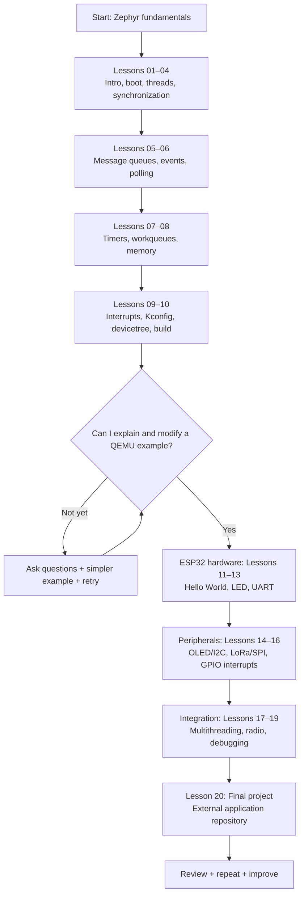
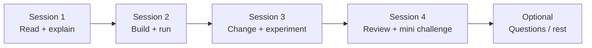
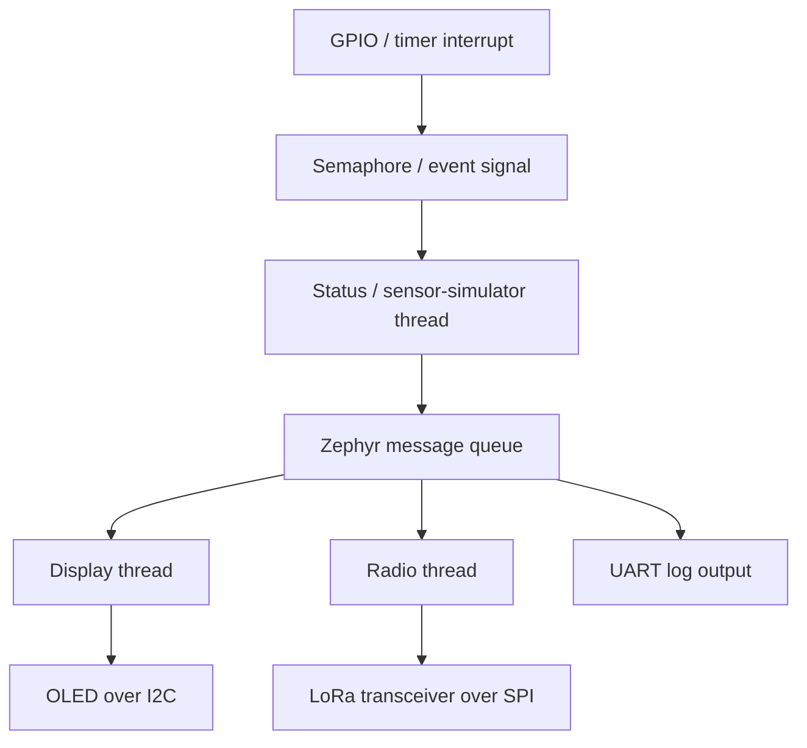

# 00 — Guide to Learning Zephyr RTOS

> **Our master roadmap, weekly proposal, practice notebook, and progress tracker**  
> Platform: **Windows + PowerShell**, starting with **QEMU (`qemu_x86`)**, then **Heltec WiFi LoRa 32 V2 (ESP32 + SX1276/SX1278 + 0.96-inch OLED)**.  
> Learning style: **simple explanations first, then code, then hands-on experiments.**  
> **This is a flexible proposal, not a deadline. Understanding matters more than completing a week on time.**

---

## 1. The big goal

By the end, I should be able to:

1. Explain why an RTOS is needed and what Zephyr does.
2. Understand threads, priorities, synchronization, queues, events, and timers.
3. Build, run, and debug applications in QEMU and on my ESP32.
4. Control GPIO, UART, OLED (I²C), and LoRa hardware (SPI), as supported by the board and drivers.
5. Organize my **own application outside the Zephyr source repository**.
6. Build a small, documented real-world embedded project.
7. Explain key differences among **Zephyr, FreeRTOS, and ThreadX**.

**What success looks like:** I can explain the code in my own words, predict what it will print or do, make a small change, and debug it if it fails.

---

## 2. Learning roadmap — diagram



### Simple version

```text
Understand the concept
        ↓
Read a small example
        ↓
Build and run it
        ↓
Change ONE thing
        ↓
Predict the result, then test
        ↓
Explain it in my own words
        ↓
Move to the next lesson
```

**Rule:** A lesson is *not* complete merely because its README was generated or read. It is complete when I understand it and have attempted its exercise.

---

## 3. Current learning status — important!

Status is based only on what we have discussed, **not** an assumption that everything has been read.

| Lesson | Topic | Material status | My learning status |
|---|---|---|---|
| 01 | Introduction to Zephyr | Prepared earlier | Review whenever useful |
| 02 | Boot process and `main()` | Prepared earlier | Review whenever useful |
| 03 | Threads and scheduling | Prepared; QEMU demo run earlier | Revisit if needed |
| 04 | Semaphores, mutexes, race conditions | Prepared earlier | Verify example and understanding |
| 05 | Message queues and inter-thread communication | Prepared earlier | **Not yet reviewed / planned** |
| 06 | Events, polling, notifications | Prepared earlier | **Not yet reviewed / planned** |
| 07 | Timers, delayed work, workqueues | Prepared earlier | **Not yet reviewed / planned** |
| 08 | Stacks, heaps, memory slabs/pools | Prepared earlier | **Not yet reviewed / planned** |
| 09 | Interrupts, ISRs, deferred processing | Prepared earlier | **Not yet reviewed / planned** |
| 10 | Kconfig, devicetree, build system | **Still to create** | Not started |
| 11–20 | ESP32 hardware + final project | **Proposed roadmap** | Not started |


---

## 4. Our study method — simple and repeatable

For **each lesson** use the **20–20–15–5 method** (about 60 minutes; shorten or split it when needed):

| Time | Activity | Result |
|---|---|---|
| 20 min | Read the README, slowly | I can state what the feature does |
| 20 min | Type or copy the demo, build, run | I see the expected output |
| 15 min | Make ONE small change | I see how behavior changes |
| 5 min | Explain it in plain words | I know what I understood and what is still unclear |

If 60 minutes is too much, do only the reading or the experiment that day. **No catching-up penalty.**

### The 5-question understanding check

Before marking a lesson complete, answer:

1. **What problem** does this feature solve?
2. **When would I use it** in a real project?
3. **Which Zephyr API** is the main one?
4. **What happens if I remove or change** one important line of code?
5. **How does it compare** with FreeRTOS and ThreadX?

You do not need perfect textbook answers. Use your own words.

### Three levels of practice

- **Level 1 — Run:** Compile and run the example without errors.
- **Level 2 — Change:** Modify a priority, delay, queue size, or log message. Predict the result.
- **Level 3 — Create:** Write a tiny variation without looking at the solution.

Only Level 1 is necessary on a busy day. Aim for Levels 2–3 over time.

---

## 5. Proposed 10-week plan (flexible)

**Suggested rhythm:** 4 study sessions per week, about 30–60 minutes per session. One extra day is optional for revision; remaining days can be rest days. Move a week forward only when comfortable.

| Week | What to learn | Practice / mini-challenge | End-of-week proof |
|---|---|---|---|
| **1** | **Lesson 05:** Message queues; **Lesson 06:** Events and polling | Producer–consumer queue; event bits or signal wake-up | Explain when a queue is better than a semaphore |
| **2** | **Lesson 07:** Timers and workqueues; **Lesson 08:** Memory | Periodic timer + deferred work; allocate and release slab/heap memory | Explain ISR versus workqueue; stack versus heap |
| **3** | **Lesson 09:** Interrupts; **Lesson 10:** Kconfig/devicetree/build (when ready) | Show deferred processing; change a `prj.conf` setting and rebuild | Explain why interrupt handlers must be short |
| **4** | **Lesson 11:** ESP32 setup and flashing; **Lesson 12:** GPIO | Flash Hello World; blink a board LED **after checking its pin and polarity** | Serial output plus visible LED behavior |
| **5** | **Lesson 13:** UART; **Lesson 14:** OLED over I²C | Print useful status over UART; draw text on OLED | OLED displays a changing counter |
| **6** | **Lesson 15:** SPI / LoRa chip; **Lesson 16:** GPIO interrupts | Inspect radio communication or chip ID; test an input interrupt | Explain SPI transactions and ISR-to-thread handoff |
| **7** | **Lesson 17:** Multitasking; **Lesson 18:** LoRa communication | LED heartbeat + OLED status + radio task; packet TX/RX **only with compatible receiver and legal radio settings** | Demonstrate two tasks working independently |
| **8** | **Lesson 19:** Debugging, logging, stack usage, errors | Intentionally introduce a small bug and fix it | A short troubleshooting log |
| **9** | **Lesson 20:** Final-project architecture and external app layout | Move app to its own folder/repository; split into `main`, `display`, `radio`, `status` modules | Clean external application that builds |
| **10** | Final-project integration, tests, and documentation | Run a working monitoring-node demo; document setup and limitations | Reproducible build + README + demonstration |

**This is a recommended sequence, not a prediction that every feature will work automatically.** OLED, LoRa, GPIO, and wireless-driver steps may need overlays, board-specific pin checks, or additional configuration.

### How a typical week looks



**Fallback plan for busy weeks:** one lesson + one successful experiment = a good week.

---

## 6. Practice checklist for Lessons 05–10

### Lesson 05 — Message queues

- [ ] Explain: *A queue is a mailbox that can hold messages.*
- [ ] Run a producer–consumer example using `k_msgq_put()` and `k_msgq_get()`.
- [ ] Change the queue depth. What happens when it becomes full?
- [ ] Explain: queue vs semaphore vs shared global variable.

### Lesson 06 — Events and polling

- [ ] Explain event bits using a real-life example (several switches/flags).
- [ ] Try `k_event_post()` and `k_event_wait()` or `k_event_wait_all()`.
- [ ] Observe a `k_poll()`-based wake-up example.
- [ ] Explain polling on kernel objects vs a CPU-wasting `while(1)` busy loop.

### Lesson 07 — Timers and workqueues

- [ ] Make a periodic timer tick and wake a thread.
- [ ] Schedule work on a workqueue.
- [ ] Change a delay and observe the effect.
- [ ] Answer: why shouldn't a timer expiry callback do long/blocking work?

### Lesson 08 — Memory management

- [ ] Explain static memory, thread stack, system heap, and slab.
- [ ] Allocate a block and release it correctly.
- [ ] Make a fixed slab full, then handle the failure safely.
- [ ] Explain why memory leaks and stack overflow matter in embedded devices.

### Lesson 09 — Interrupts

- [ ] Explain: an interrupt is the CPU being told to handle something urgent.
- [ ] Know what *interrupt context* means.
- [ ] Signal a thread from short interrupt-context work.
- [ ] Explain why sleeping or performing heavy work inside an ISR is wrong.

### Lesson 10 — Configuration and build (upcoming)

- [ ] Understand what `prj.conf` changes.
- [ ] Understand what a Devicetree overlay describes.
- [ ] Know the role of `CMakeLists.txt`.
- [ ] Change one option, build pristine, inspect the result.

### Reuse challenge (after Lesson 10)

Build a **QEMU status simulator**: one thread updates a counter, another receives it through a queue, and a timer triggers periodic status output. This combines Lessons 03, 05, and 07.

---

## 7. Hardware roadmap for our exact board

**Board:** Heltec WiFi LoRa 32 V2, ESP32, SX1276/SX1278-class radio, 0.96-inch 128×64 OLED, CP2102 USB-to-UART, approximately 4 MB flash (per your board specifications).

**Zephyr board identifier:** `heltec_wifi_lora32_v2`  
**Board target documented by Zephyr:** `heltec_wifi_lora32_v2/esp32/procpu`

Official references:

- Board: https://docs.zephyrproject.org/latest/boards/heltec/heltec_wifi_lora32_v2/doc/index.html
- External applications: https://docs.zephyrproject.org/latest/develop/application/index.html

> **Board caution:** Zephyr's documentation lists this board as **not actively maintained**. So each hardware demo should be tested with your exact checkout, pins, and driver availability. If an OLED or radio example needs custom configuration, that becomes part of the lesson—not a reason to abandon the board.

### Hardware experiments (easy → difficult)

```text
USB serial Hello World
        ↓
LED blink (verify board LED wiring)
        ↓
UART logging
        ↓
OLED text / counter over I²C
        ↓
SPI peripheral + LoRa transceiver check
        ↓
GPIO interrupt experiment
        ↓
Multiple Zephyr tasks working together
        ↓
LoRa packet exchange (requires a second compatible radio)
        ↓
Final monitoring-node application
```

### Safety and practical checks

- Connect a suitable antenna **before any LoRa transmission**.
- Match the frequency plan and transmission settings to **local radio regulations**; a listing that says 915 MHz does not automatically authorize 915 MHz transmission where you live.
- A full transmit-and-receive test requires a **second compatible LoRa device** (or another suitable receiver). With one board, start with serial, OLED, SPI, and local application exercises.
- Verify the LED GPIO and display reset/enable wiring against your specific V2 hardware before changing the pins.
- Wi-Fi/Bluetooth are **advanced optional lessons**, not guaranteed to be supported by every Zephyr driver combination.

---

## 8. Application directory plan — do not edit the Zephyr kernel

We decided to learn with a simple structure first and adopt a cleaner standalone repository for the final project.

### Lessons 01–10 — keep existing examples

```text
C:\Users\ragha\workspace\personal\zephyrproject\
├── .venv\
├── zephyr\
│   ├── kernel\
│   └── myapp\
│       ├── lesson03_threads\
│       ├── lesson04_sync\
│       ├── lesson05_message_queues\
│       ├── lesson06_events_polling\
│       ├── lesson07_timers_workqueues\
│       ├── lesson08_memory_management\
│       └── lesson09_interrupts\
└── build\
```

### Lessons 11–19 — app outside the Zephyr repository, inside the west workspace

```text
zephyrproject\
├── .west\
├── .venv\
├── zephyr\                <-- external RTOS source; leave untouched
├── modules\
├── myapp\                 <-- OUR applications, outside zephyr\
│   ├── lesson11_hello\
│   │   ├── src\main.c
│   │   ├── prj.conf
│   │   └── CMakeLists.txt
│   ├── lesson12_gpio\
│   ├── lesson13_uart\
│   └── ...
└── build\
```

### Lesson 20 — professional freestanding application

```text
workspace\
├── zephyrproject\         <-- Zephyr / SDK workspace
│   ├── zephyr\
│   ├── modules\
│   └── .venv\
└── esp32_lora_project\    <-- OUR separate Git repository
    ├── src\
    │   ├── main.c
    │   ├── display.c
    │   ├── radio.c
    │   └── status.c
    ├── include\
    ├── boards\
    ├── prj.conf
    ├── CMakeLists.txt
    └── README.md
```

**Important:** In Zephyr, the application is built and linked together with the RTOS. Zephyr is an *external source dependency*, not normally a drop-in precompiled `.lib`.

---

## 9. Copy-paste build commands (Windows PowerShell)

### QEMU example — Lesson 05 (from the `zephyr` folder)

```powershell
cd C:\Users\ragha\workspace\personal\zephyrproject\zephyr
..\.venv\Scripts\Activate.ps1
west build -p always -b qemu_x86 .\myapp\lesson05_message_queues -d ..\build\lesson05_message_queues
west build -d ..\build\lesson05_message_queues -t run
```

Repeat this pattern with the matching application directory for each lesson. Using `-p always` prevents a stale build directory from accidentally running an earlier lesson.

### ESP32 check — when we reach Lesson 11 (from the `zephyrproject` folder)

```powershell
cd C:\Users\ragha\workspace\personal\zephyrproject
.\.venv\Scripts\Activate.ps1
west boards | Select-String "heltec_wifi_lora32_v2"
west blobs fetch hal_espressif
```

After confirming the target and prerequisites, a typical build will look like:

```powershell
west build -p always -b heltec_wifi_lora32_v2/esp32/procpu .\myapp\lesson11_hello -d .\build\lesson11_hello
west flash -d .\build\lesson11_hello
```

The `lesson11_hello` source folder must exist first. Verify the exact board target and serial port on your setup before flashing.

### Where the application files belong

Each lesson application uses:

```text
lessonXX_name\
├── CMakeLists.txt
├── prj.conf
└── src\
    └── main.c
```

---

## 10. Revision day: explain it like I'm 10

On review day, say each concept in a single simple sentence:

| Technical term | Simple explanation |
|---|---|
| Thread | A worker that does a job |
| Scheduler | The manager who decides which worker runs |
| Semaphore | A signal or limited set of tickets |
| Mutex | A key used to protect one shared thing |
| Message queue | A mailbox that stores messages |
| Event bits | Little yes/no flags for things that happened |
| Timer | An alarm clock for the program |
| Workqueue | A helper worker that performs queued jobs |
| Stack | A worker's private short-term workspace |
| Heap | Shared memory requested when needed |
| Memory slab | A box of equal-size reusable blocks |
| Interrupt | Urgent attention from hardware / a timer |
| Kconfig | Which software features are enabled |
| Devicetree | How the hardware is described to software |

If a definition is still confusing, do not memorize it. Ask for an analogy plus a smaller code example.

---

## 11. Copy this learning log after each study session

```markdown
### Study log — YYYY-MM-DD
- Lesson: 
- Read: [ ] yes  [ ] partly  [ ] not yet
- Built and ran: [ ] yes  [ ] no
- What I understood (my own words):
  - 
- What I changed in the code:
  - 
- What happened / output:
  - 
- What confused me:
  - 
- Need: [ ] simpler explanation  [ ] diagram  [ ] tiny C example  [ ] debug help
- My status: [ ] Not started  [ ] Reading  [ ] Practiced  [ ] Understood
```

### Example question to send when something is unclear

> **Lesson 07 — I don't understand delayed work.** Please explain it like I'm 10 years old. First explain with a real-world example, then compare `k_timer` vs `k_work_delayable`, then show me the smallest possible Zephyr program. Tell me exactly what happens line by line.

Or simply paste **the exact paragraph, code line, build error, or console output** you are stuck on. We will rewrite that specific part and, if you want, update the corresponding lesson README.

---

## 12. Progress tracker (edit as we go)

Legend: `⬜ Not started` · `📖 Reading` · `🛠 Practicing` · `✅ Understood` · `🔁 Revisit`

| Lesson | Status | Questions / notes |
|---|---|---|
| 01 | 🔁 Review when needed | |
| 02 | 🔁 Review when needed | |
| 03 | 🛠 Demo ran earlier | |
| 04 | 🔁 Check practice | |
| 05 | ⬜ Pending reading | |
| 06 | ⬜ Pending reading | |
| 07 | ⬜ Pending reading | |
| 08 | ⬜ Pending reading | |
| 09 | ⬜ Pending reading | |
| 10 | ⬜ Lesson not created yet | |
| 11–20 | ⬜ Future hardware lessons | |

**Our rule:** When you tell me *“I read Lesson XX but don't understand Y”*, we **update the explanation and the guide**, not your progress based only on elapsed time.

---

## 13. Final-project idea — Heltec LoRa status node

### Desired result

A small ESP32 Zephyr program that:

- Runs separate tasks for status/heartbeat, display updates, and radio handling.
- Shows useful data on the 0.96-inch OLED.
- Logs events on USB serial for debugging.
- Uses a queue for messages and events/semaphores to notify tasks.
- Communicates over LoRa **if** a second compatible radio, driver support, and legal frequency configuration are available.
- Has a clean source layout outside the Zephyr repository.

### High-level architecture



*We can start with simulated measurements, so no extra sensor purchase is required.*

### Final-project completion checklist

- [ ] External application structure builds without copying or editing Zephyr source.
- [ ] README contains exact build and flash commands.
- [ ] OLED display works (or a documented UART fallback if display support is blocked).
- [ ] Multiple threads synchronize safely.
- [ ] Logging helps identify failures.
- [ ] LoRa test is documented honestly as **tested**, **not tested**, or **blocked**.
- [ ] I can explain what happens from reset to application behavior.

---

## 14. Our agreement

1. **Learn slowly.** Today's reading plan can change tomorrow.
2. **Focus on understanding, not counting lessons.**
3. **Practice after reading.** One small modification teaches more than many copied programs.
4. **Keep examples simple at first.** Use QEMU before tricky hardware configuration.
5. **Use the real ESP32 V2 board for hardware lessons**, with STM32H7B3 as a possible backup.
6. **Keep application code separate from Zephyr** from Lesson 11 if the setup is straightforward; use a fully independent application repository for the final project.
7. **Ask questions freely.** Any confusing lesson can be rewritten in easier language, with analogies, diagrams, and step-by-step code.

**Next action:** Begin reading **Lesson 05** when you're ready. Then practice it and tell me what feels unclear before moving on.

*Last planned revision: 28 October 2026. This is a living guide; update the checkboxes, dates, and pace whenever needed.*
